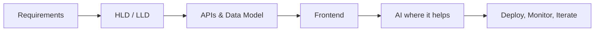

<div align="center">
  <a href="https://deepaksharma-39.github.io/">
    
  </a>
</div>

<div align="center">
  
</div>

<div align="center">
  <a href="https://deepaksharma-39.github.io/"></a>
  <a href="https://app.mapglo.com"></a>
  <a href="mailto:deepaksharmaa.39@gmail.com"></a>
  <a href="https://www.linkedin.com/in/d33pak-sharma/"></a>
</div>

<br />

> **🟢 Open to full-time roles:** Senior Full Stack · Backend (Node.js) · AI / Full-Stack AI Engineer · Remote (India) or any metro · 60-day notice (negotiable)

<table>
<tr>
<td width="58%" valign="top">

## 👋 About Me

Senior Full Stack Engineer with **3+ years** shipping production SaaS at **TechPlek Technologies**, growing from Associate → Team Lead → Senior Developer.

I architect multi-tenant platforms end to end (HLD / LLD, data models, API contracts) and build them with **React / Next.js, Node.js / Express, TypeScript, MongoDB / MySQL and AWS**. Lately I've been building **agentic AI pipelines on GPT-4o** and launched **[Mapglo](https://app.mapglo.com)**, a two-sided location-intelligence SaaS.

</td>
<td width="42%" valign="top">

```yaml
name: Deepak Sharma
role: Senior Full Stack Engineer
experience: 3+ years (TechPlek Technologies)
core: [React, Next.js, Node.js, TypeScript, AWS]
ai: [GPT-4o, agentic pipelines, tool calling]
domains: [logistics, hospitality, travel,
          e-commerce, AdTech, location intel]
open_to: Full-time roles · remote or metro
location: Delhi, India
```

</td>
</tr>
</table>

---

## 📈 Impact Highlights

- 🤖 Built an **agentic AI pipeline on OpenAI GPT-4o** that turns client Excel files into BI reports, cutting manual analyst work by **40%**.
- 🗺️ Designed and launched **Mapglo**, an OOH location-intelligence SaaS with **3 role-based portals** (agency, vendor, admin) and geospatial data.
- 👥 Led a **4-member frontend team**: set up coding standards, PR reviews and sprint cadence; cut delivery timelines by **20%** and production defects by **25%**.
- ⚡ Introduced RTK Query for API state, removing redundant fetch logic and improving team throughput by **~30%**.
- 🏗️ Own delivery from scoping and architecture to code review and production deployment on Linux / AWS.

---

## 🚀 Featured Work

| Project | What it is | Stack |
| --- | --- | --- |
| **[Mapglo](https://app.mapglo.com)** | Two-sided OOH location-intelligence SaaS: discover, compare and shortlist outdoor media sites, with agency, vendor and admin portals | React, Node.js, MongoDB, geospatial data |
| **[Location Intelligence Tool](https://github.com/Deepaksharma-39/Location-Intelligence-tool)** | AI-enabled location analysis: opportunity scoring, hotspot dashboard and an LLM advisor endpoint | React + Vite, Node.js / Express, Zod, OpenAI |
| **[All Tax Solutions Platform](https://github.com/Deepaksharma-39/all-tax-solutions-mobile-app)** | Multi-channel platform: customer site, admin dashboard and Expo mobile app on one JWT-secured API | React, Redux Toolkit, Expo / React Native, Node.js, MySQL / Sequelize |
| **Aavya Holidays** | Multi-resort privilege membership-card platform with SMS OTP and per-property rules | React, Node.js |
| **TripBiller V2** | Transport operations SaaS: Express REST API, React / Vite admin and Expo mobile app | React, Node.js, MongoDB, Redis, Docker, AWS S3 |
| **VitaVista** | Multilingual (5-locale) e-commerce store with Stripe, Razorpay, SSLCommerz and COD checkout | Next.js, MongoDB, NextAuth, AWS S3 |
| **Xperia BD** | Geospatial campaign intelligence: auto-enriches ad sites with POIs, traffic and census data | Node.js, MongoDB, Agenda, Google Maps APIs, Puppeteer |

<sub>Most client work lives in private repositories; happy to walk through the architecture in an interview.</sub>

---

## 🧰 Tech Stack

<div align="center">

| Layer | Tools & Technologies |
| --- | --- |
| **Frontend** | React 18 / 19, Next.js, TypeScript, Redux Toolkit, RTK Query, Vite |
| **Backend** | Node.js, Express.js, REST APIs, JWT / RBAC, Joi / Zod validation, background jobs |
| **Databases** | MongoDB, MySQL, PostgreSQL, Redis, Sequelize |
| **AI** | OpenAI GPT-4o, agentic pipelines, tool calling, LLM integration |
| **Mobile** | React Native, Expo |
| **Cloud & DevOps** | AWS, Docker, GitHub Actions, Linux, Nginx / Apache, SSL |
| **Practices** | System design (HLD / LLD / DFD), multi-tenant SaaS, code review, Agile / GitFlow |

</div>

---

## 🏗️ How I Work



---

## 🤝 Hiring?

I'm looking for a team building real products where I can own features end to end, across full-stack, backend or AI.

<div align="center">
  <a href="mailto:deepaksharmaa.39@gmail.com"></a>
  <a href="https://www.linkedin.com/in/d33pak-sharma/"></a>
  <a href="https://deepaksharma-39.github.io/projects.html"></a>
</div>
